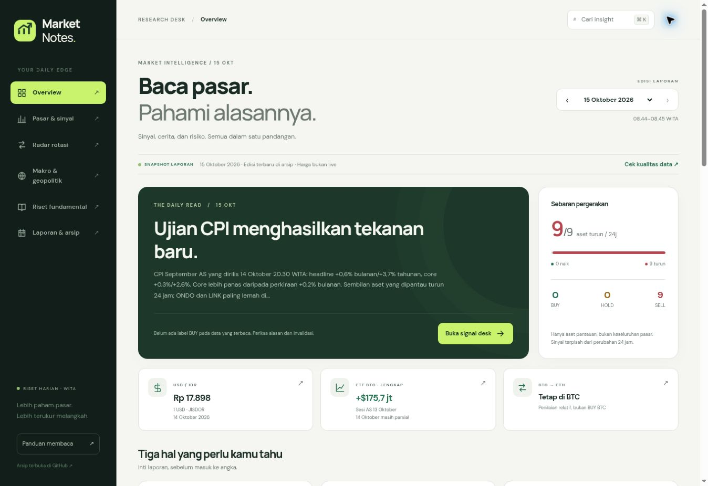

# Market Notes — dashboard v2

An Indonesian research dashboard built from the dated Markdown files in `crypto-recaps/`. No credentials, market API keys, or runtime backend are needed. It never places orders or refreshes archived quotes as live prices.



## Build and deploy

```sh
python3 dashboard/build.py
```

The output directory remains `dist`. Root `wrangler.jsonc` explicitly runs the Python build and deploys `dist`, so Wrangler cannot accidentally auto-detect and publish the unrendered template. Keep the build root at the repository root and deploy with `npx wrangler deploy`. New recap commits are included on the next automatic deployment. Do not commit `dist`.

## Validate

```sh
python3 -m unittest discover -s dashboard -p 'test_*.py'
python3 dashboard/build.py
node --check dashboard/app.js
node dashboard/test_app.cjs
```

The regression checks cover mixed Indonesian/English financial notation, historical prices without a `$` prefix, separation of signal labels from conditional triggers, exact oil observations, escaped Markdown, ETF completeness, and all six views against every real archive. Node is only needed for development checks; the production build uses the Python standard library.

## Interface

- Overview: source-based briefing, market breadth, dated USD/IDR and ETF observations, changes, agenda, and Stories.
- Market: asset and signal filters, snapshot comparison, sampled archive charts, signal reasons and invalidation, and original drawdown methodology.
- Rotation: perpetual DEX, RWA, and BTC → ETH, with conditional status separate from asset BUY/SELL labels.
- Macro: complete/partial ETF flows, oil observations, dated FX, geopolitical scenarios, and WITA agenda.
- Research: QNT/HYPE/LINK/ONDO, supply warnings, other fundamentals, and the dated Signal Deck comparison.
- Archive: complete source report, table of contents, UTF-8 Markdown download, and source links.

Deep links retain `?date=YYYY-MM-DD` and accept `&view=market|rotation|macro|research|library`. The default is the newest report. Older `#section-N` links open the full report. Theme is stored locally; there is no account, personal portfolio storage, analytics, or tracking backend.

## Data contract

Use a main price table headed `Aset | Harga USD | 24 jam`. Supported alternate 24-hour headings remain accepted. The nine fixed assets are BTC, ETH, SOL, BNB, XRP, HYPE, QNT, LINK, and ONDO; older six-asset reports remain readable.

Use `Aset | Support | Resistance | Sinyal | Pemicu & alasan | Invalidasi | Horizon` for technical labels. The dashboard reads the **Sinyal column only**, and never turns trigger text into a new signal. Missing labels stay missing.

Use a second-level heading (`##`) for report sections. The established titles `Rotasi dalam sektor`, `Rotasi BTC → ETH`, `Kurs USD/IDR`, `Skenario geopolitik`, and `Minyak — 1 bulan` enable the specialized views. Sector rotation opening paragraphs remain fully available in Stories and the radar.

Oil plots accept only the consistent two-column table `Tanggal | Brent (USD/barel)` (or explicitly WTI), ISO dates and dot-decimal values. Missing days are never inserted. Chart points keep their actual observation dates and source series; futures settlements are not appended to spot charts.

Crypto charts are **archive snapshot charts**, not OHLC candles or tick histories. Snapshot time, provider and methodology can differ between editions. They must not be used to recompute candle confirmations or claimed rolling drawdowns. Display archived drawdowns only with their original definitions.

ETF headline cards require a recognizable `Sesi AS` table with a status column, an explicit complete session, and a supported USD-million unit. Unrecognized formats remain readable in the full report; they never become a guessed zero or total. Daily research in Markdown remains the source of truth.

## BTC Risk Desk integration

`btc.js` renders the native read-only BTC panel. On the public site it offers a top-level sign-in handoff to the existing private Risk Desk `/hub?view=btc`. The private hub proxies the public recap and allowlisted static assets without forwarding credentials. It reads `/api/hub-btc` on that same private origin; no cross-origin access token, public signal dump, order execution, journal, position, or capital data is embedded here.

The private hub reads the current public deployment, so future recap commits are visible without copying archives or republishing the private Site. Existing analyst and monitoring writers are unchanged. The BTC feed refreshes when opened and every 60 seconds while visible, with a manual refresh control. Report validity, 3-minute feed/tracker freshness, and event windows gate its displayed status. A mechanically confirmed tracker remains separate from an analyst decision and spot labels.
